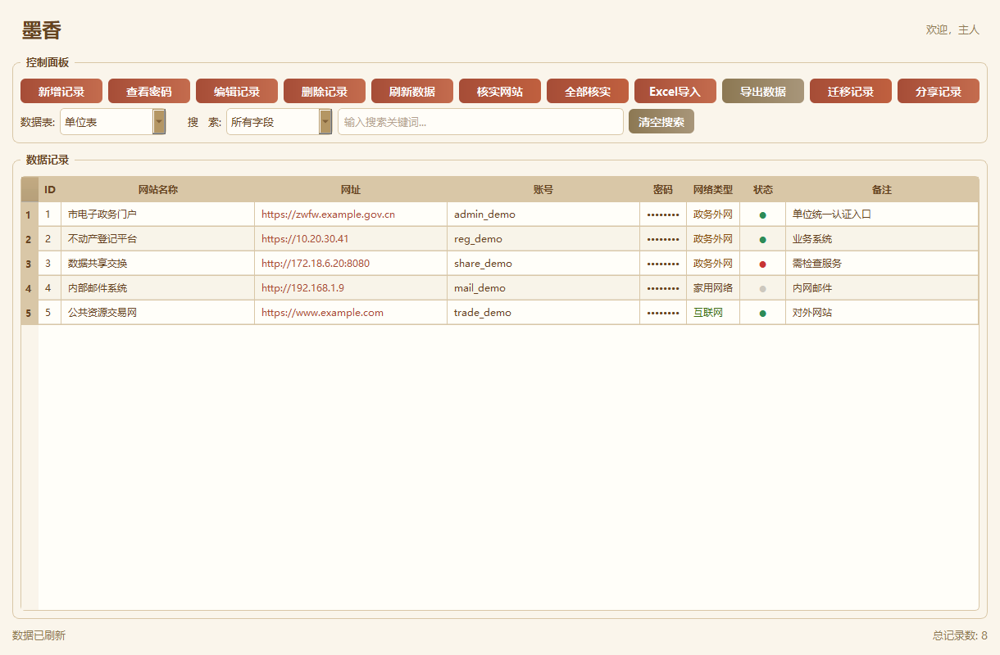
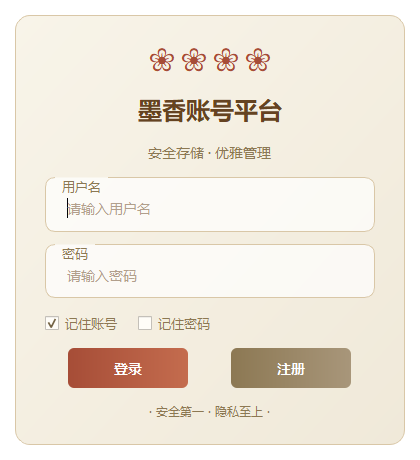
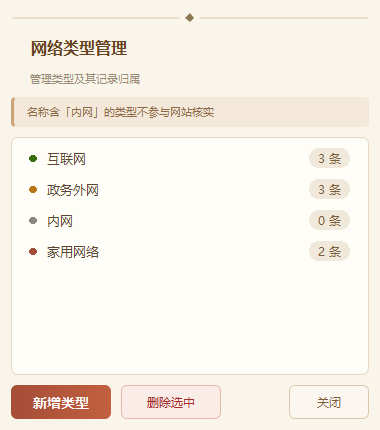
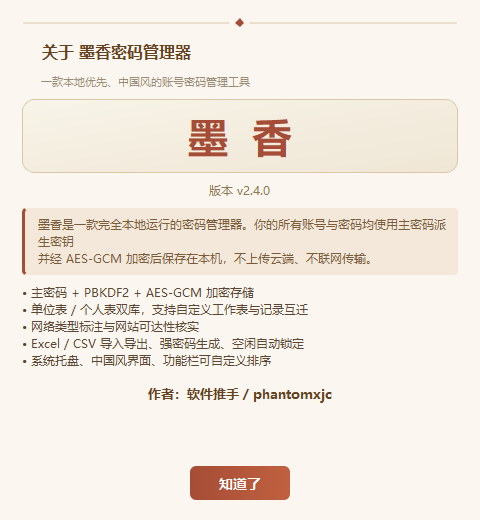

# 墨香密码管理器

> 一款**本地优先、中国风**的账号密码管理工具。你的数据只属于你自己。

`墨香` 是一款基于 PyQt5 开发的桌面密码管理器。所有账号与密码均使用**主密码派生的密钥**经 **AES-GCM** 加密后保存在本机，不上传云端、不联网传输。它由早期单文件脚本重构而来，采用标准项目架构，当前版本 **v2.4.0**。



---

## 为什么选择墨香

- **真正本地**：无账号体系、无云端同步、无遥测。数据文件就在你的硬盘上。
- **强加密**：PBKDF2（100 万次迭代）派生密钥 + AES-GCM 认证加密，主密码本身不落盘。
- **中国风**：暖米底色、朱红点缀、菱形节点装饰线，界面素雅耐看。
- **为国内网络环境设计**：内置政务外网 / 互联网 / 内网等网络类型，支持 IP 与网址识别、网站可达性核实。

---

## 功能一览

| 功能 | 说明 |
| --- | --- |
| 🔐 加密存储 | 主密码 + PBKDF2 + AES-GCM，密文落盘，泄露数据库也无法直接读取 |
| 📝 双表管理 | 单位表 / 个人表独立增删改查与搜索，支持记录互迁 |
| 🗂 动态工作表 | 右键可新建自定义工作表，灵活分类 |
| 🌐 网络类型 | 每条记录标注「互联网 / 政务外网 / 内网」等类型，类型可自定义管理 |
| 🔎 网站核实 | 单条 / 批量探测网址可达性，状态以 🟢 / 🔴 / ⚪ 圆点呈现 |
| 🧰 密码生成器 | 一键生成高强度随机密码 |
| ⏲ 空闲锁定 | 离开自动锁定，锁定后隐藏到托盘，双击托盘才弹登录 |
| 📤 导入导出 | Excel / CSV 导入导出，导出需主密码授权，可勾选记录 |
| 💾 记住账号 | 默认只记账号；勾选后可记密码，仍加密保存 |
| 🎨 界面定制 | 功能栏顺序可拖拽排序，全应用统一中国风 |

---

## 界面预览

### 登录

主密码验证进入，支持「记住账号 / 记住密码」选项。



### 主窗口

第一行功能栏、第二行数据表与搜索。表格展示网站名称、网址、账号、掩码密码、网络类型、可达状态与备注。


### 网络类型管理

右键「欢迎，主人」→「网络类型管理」，可新增 / 删除类型并查看各类型记录数。名称含「内网」的类型不参与网站核实。



### 关于

右键「欢迎，主人」→「关于墨香」，查看软件介绍、版本与作者信息。



> 截图中的账号、网址、备注均为演示假数据，与任何真实信息无关。

---

## 网络类型识别规则

内置默认识别逻辑（可在管理界面调整）：

| 特征 | 判定为 |
| --- | --- |
| `10.x` / `172.16~31.x` 网段 | 政务外网 |
| `.gov.cn` 域名 / 含 `zwfw` | 政务外网 |
| `192.168.x` 网段 | 家用网络 |
| DNS 解析失败 | 内网 |
| 其他 | 互联网 |

---

## 快速开始

### 方式一：直接运行（推荐）

1. 到 [Releases](../../releases) 下载最新的 `MoxiangPasswordManager_vX.X.X.zip`（如 v2.4.0）。也可直接下载 [v2.4.0 压缩包](https://github.com/phantomxjc/account_manager/releases/download/v2.4.0/MoxiangPasswordManager_v2.4.0.zip)。
2. 解压到一个文件夹（建议固定目录，如 `D:\墨香密码管理器`）。
3. 双击 `墨香密码管理器.exe`，首次使用先「注册」创建主密码。

> 注意：请解压到**你有写入权限**的目录。软件会在 exe 同级目录生成数据库与备份。

### 方式二：源码运行

```bash
pip install -r requirements.txt
python -m moxiang
# 或
python src/launcher.py
```

### 打包为 exe

```bash
pip install -r requirements.txt
python build.py                 # 默认输出到 H:\墨香密码管理器
python build.py --dest D:\path  # 自定义输出目录
```

打包产物为 onedir（文件夹）形式，入口为 `墨香密码管理器.exe`。

---

## 数据安全说明

- 数据库 `password_manager.db`、记住账号文件 `remember.json`、配置 `mx_config.json`、备份目录 `backups/` 均**包含个人或敏感信息，已加入 `.gitignore`，永远不会进入本仓库**。
- 本仓库只保存源代码与文档截图，截图内数据均为演示假数据。
- 导出的 Excel / CSV 为**明文密码**，请妥善保管并及时删除。

---

## 项目结构

```
墨香密码管理器/
├── build.py                  # PyInstaller onedir 打包脚本
├── requirements.txt          # 依赖清单
├── resources/
│   └── 枫叶.ico              # 应用图标
├── docs/screenshots/         # README 演示截图（假数据）
└── src/
    ├── launcher.py           # 冻结入口
    └── moxiang/              # 主包
        ├── app.py            # 应用控制器 / 托盘 / 入口
        ├── config.py         # 路径 / 配置 / 网络类型 / 工具栏排序
        ├── crypto.py         # 密钥派生与加解密
        ├── database.py       # 数据访问层
        ├── netcheck.py       # 网址 / IP 识别与可达性探测
        ├── style.py          # 中国风样式与自绘控件
        ├── single_app.py     # 单实例
        ├── icon.py           # 图标加载
        └── ui/
            ├── login_window.py   # 登录窗
            ├── main_window.py    # 主窗
            └── dialogs.py        # 各类对话框（含关于窗）
```

---

## 作者

**软件推手 / phantomxjc**

- GitHub：[@phantomxjc](https://github.com/phantomxjc)
- 如果这个项目对你有帮助，欢迎点一个 ⭐ Star。

---

## 许可

本项目仅供个人学习与本地使用。请勿用于非法用途。
